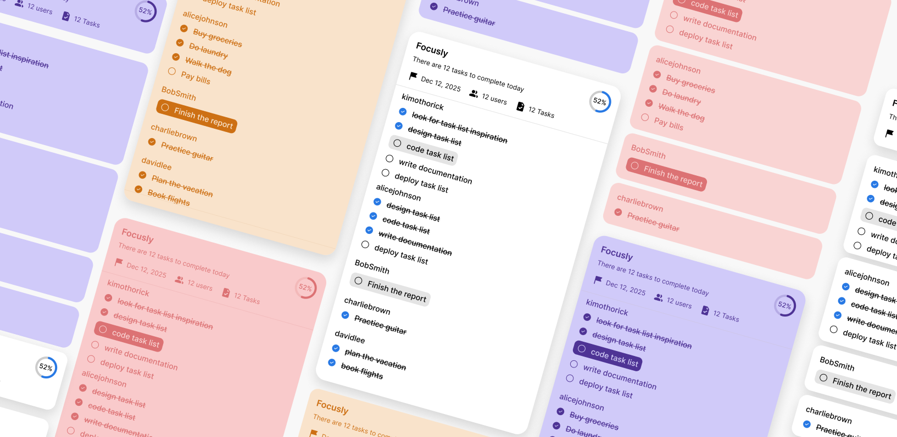
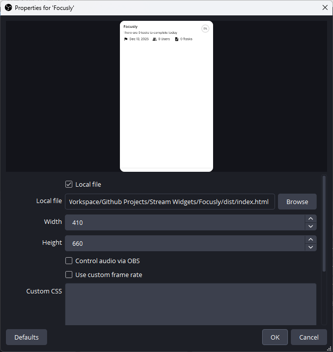

  

# Focusly - Twitch Task Bot

 

Focusly is a task management bot for Twitch streamers and viewers, designed for coworking and studying in real time.
With Focusly, you can manage tasks, track progress, and stay organized during streams without needing external tools. It
uses a simple, customizable overlay for task management, allowing viewers to interact and stay productive.

## Features

- 📝 Task Management: Add, edit, remove, finish, and view tasks.
- 🎨 Customizable UI: Set your task list’s appearance, fonts, and layout.
- 🎮 Commands for Streamers and Viewers: Different commands for managing tasks, progress, and more.
- 🔧 Admin Control: Moderators can delete tasks or clear task lists.
- ⏱️ Real-time Task Updates: Streamers and viewers can interact with the task list in real time.

## Getting Started

### Prerequisites

1. **Twitch Account**:  
   You can use your existing Twitch account or create a new one specifically for the bot.

2. **OAuth Token**:
   Generate an OAuth token to allow the bot to connect to Twitch and perform actions on your behalf.
    - Visit the [Twitch Chat OAuth Password Generator](https://twitchtokengenerator.com/) website.
    - Log in with the Twitch account you want the bot to operate under.
    - Approve the requested permissions for the token generator.
    - Copy the generated token (it will start with oauth:). You'll need this for the bot configuration.
    - Important: Treat this token like a password. Do not share it publicly.

### Setup

1. **Download the Repository**  
   [Download the repository as a ZIP file](https://codeload.github.com/kimothorick/Focusly/zip/refs/heads/main) and
   extract it to your preferred
   location on your computer.

2. **OBS Setup**
    - Add a browser source to your desired scene and name it whatever you want.
    - In the properties, choose Local file and locate the `index.html` file from the `dist` folder in the repository you downloaded and
      extracted as instructed above.
    - Set the `width to 410` and `height to 660`.
      After all that, your properties should be similar to this:  
      

### Configuration

The easiest way to configure Focusly is using the built-in Settings Page. This interface allows you to:
- **Connect** your Twitch account (Channel, Username, OAuth).
- **Customize** the appearance, layout, and fonts.
- **Theme** the overlay with built-in presets or custom colors.
- **View** all available commands and preview bot messages.

**To access the Settings Page:**
1. Open `settings.html` in the `dist` folder using your browser (Chrome or Edge recommended).
2. Use the tabs to navigate between **Authentication**, **Appearance**, **Commands**, and **Preview**.
3. Make your changes and click **"Save Changes"**.
4. You will be prompted to select your `dist/configs.js` file to save the new settings.

> [!TIP]
> Use the **Messages** tab to see how your bot messages will look in chat, and the **Commands** tab to see a reference of all available commands.

### Enable Testing

To enable testing, toggle the **Test Mode** switch in the navigation bar of the Settings Page. This allows you to preview the app with dummy data.

> [!IMPORTANT]
> **Disable Test Mode** before clicking "Save Changes" to ensure your overlay connects to your real Twitch chat and doesn't display dummy data in OBS.

### Commands

This section is available in the **Commands** tab of the Settings Page (`settings.html`). There you can view all available commands, their usage, and descriptions.

- **Admin/Moderator Commands**: Actions like deleting specific tasks or clearing the list.
- **User Commands**: Actions like adding, editing, finishing, or removing tasks.

> [!NOTE]
> Visit the **Commands** tab in `settings.html` for the complete and up-to-date list of commands.

## Credits

This project is inspired and built on top of the [Task-List](https://github.com/mohamed-tayeh/Task-List)
by [MohFocus](https://www.twitch.tv/mohfocus)  
Author of this project is [Rick Kimotho](https://www.twitch.tv/rickphilip)
